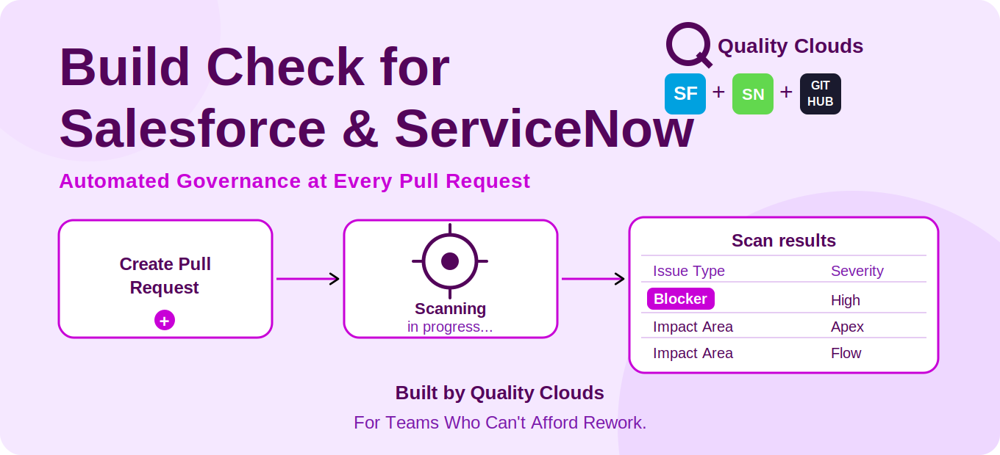

# action-full-scan

GitHub Action that scans your Salesforce or ServiceNow pull requests against Quality Clouds' governance, security, and platform-standard rules, with inline results.

## Install

Add a workflow file, for example `.github/workflows/quality-clouds.yml`:

```yaml
name: Quality Clouds
on:
  pull_request:

permissions:
  contents: read
  pull-requests: write

jobs:
  scan:
    runs-on: ubuntu-latest
    steps:
      - uses: actions/checkout@v4
      - name: Quality Clouds Scan
        uses: qualityclouds/action-full-scan@2.3.0
        with:
          mode: cloud
          token: ${{ secrets.QC_TOKEN }}
          review: true
          allIssues: true
          gitHubToken: ${{ secrets.GITHUB_TOKEN }}
          pr_fails_on_blockers: true
```

The `pull-requests: write` permission is required for `review: true` to post inline PR comments; without it, comments silently fail to post. Once a `permissions` block is set, the permissions it does not list are removed, so keep `contents: read` for `actions/checkout`.

## Authentication

Requires a Quality Clouds license. Existing customers: generate an API key in the [Admin Portal](https://qualityclouds.com/documentation/qc/admin-portal-overview/administering-api-keys/) and store it as a repository secret. The secret name is up to you: `QC_TOKEN` above is just an example, match it to whatever you name the secret in your repository settings. New to Quality Clouds: [get in touch](https://github.com/qualityclouds/community/discussions) to set up a plan for your team.

## What it does

| Input | Required | What it does |
|---|---|---|
| `token` | Yes | API key used to connect your Quality Clouds ruleset. |
| `mode` | No | `local` (default) scans a given zip file. `cloud` scans the branch the action runs on. |
| `cloud` | No | Set to `servicenow` for a ServiceNow repo. Defaults to Salesforce. |
| `url_id` | No | Quality Clouds instance id. If empty, the repository URL identifies the instance. |
| `zip_path` | In `local` mode | Path to the zip file to scan. Only used in `local` mode. |
| `review` | No | Set `true` to add inline PR comments. Only used in `cloud` mode. |
| `allIssues` | No | Set `true` to show blockers and non-blockers. Only used in `cloud` mode. |
| `gitHubToken` | If `review` is `true` | Token used to post the PR review, usually `${{ secrets.GITHUB_TOKEN }}`. |
| `pr_fails_on_blockers` | No | Set `true` to fail the check on pull requests when the Quality Gate doesn't pass. Only used in `cloud` mode. Quality Gate thresholds are configured in your Quality Clouds workspace, not in this action. |
| `version` | No | Tag of the Quality Clouds scanner image. Defaults to `latest`. |
| `api_url` | No | Quality Clouds API base URL. Only needed if Quality Clouds support gives you one. |
| `codequality` | No | Has no effect in GitHub: the results are in the job log and, with `review`, in the PR review. |

## Links

- Product: [qualityclouds.ai](https://qualityclouds.ai)
- Documentation: [qualityclouds.com/documentation](https://qualityclouds.com/documentation/)
- Questions and bugs: [community](https://github.com/qualityclouds/community/discussions)

## License

[Apache-2.0](LICENSE)

---

Built by [Quality Clouds](https://qualityclouds.ai), governing enterprise platforms since 2017.
